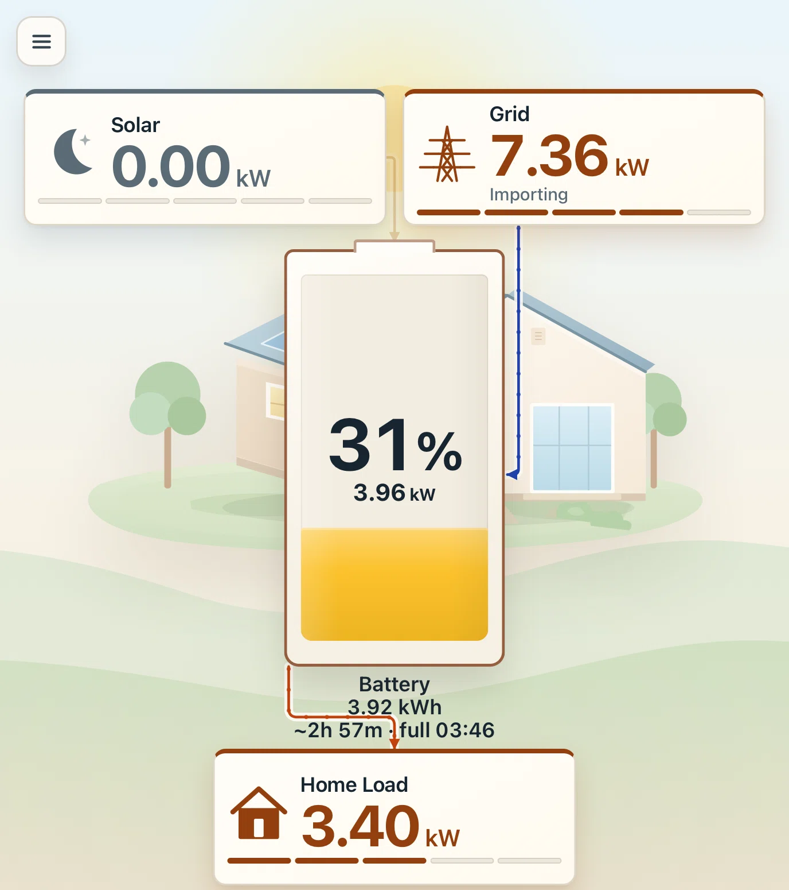

# Anker SOLIX X1 — self-hosted toolkit

The Anker SOLIX X1 is managed through Anker's cloud app. This toolkit puts a **live wall
dashboard** and a **Time-of-Use (TOU) editor** in front of the same private API, using your
own account. It runs on a local machine, NAS or small server.

<p align="center">
  
</p>
<p align="center"><em>Live dashboard on a portrait wall display. Card colour and shadow follow
the active meter band; battery text uses the page ink.</em></p>

> **Not affiliated with Anker.** This uses an undocumented private API. It can change or
> break without notice. You are responsible for what you write to your system.

## What it does

- **Live wall dashboard.** One composition around a large central battery: solar top-left,
  grid top-right and home load below. The SVG flow paths are measured from the rendered
  cards, so the wires meet the cards at any aspect ratio. The server holds one MQTT subscription
  per site and inverter. Telemetry is read-only; the only publish is the realtime wake
  request. The browser polls the local server every **2 s**.
  A drawer slider selects a **5–60 s** MQTT cadence; the choice persists across sign-out and
  account switches in its own preference cookie. Stale thresholds follow the cadence.
- **Time-of-Use editor.** Reads the site, inverter and existing plan from your account.
  Edits seasons, weekday/weekend periods, tariffs and buy/sell prices. Periods cover the full
  day and stay contiguous.
- **Verified writes.** Saves use the same `charging_hes_svc/device_command` call as the
  Anker Android app. Each write is read back and rolled back on a real mismatch, because the
  cloud is eventually consistent and a **200** response does not prove the device accepted
  the plan.
- **Whole-hour scheduling.** The editor only emits whole-hour boundaries because the
  D156/X1 applies the previous whole hour even when the cloud stores `:30`; a `:30` boundary
  is floored, so that boundary moves **30 minutes early**. See
  [`docs/FIRMWARE-LIMITS.md`](docs/FIRMWARE-LIMITS.md).
- **Multiple sites and inverters.** Sites and devices are discovered from the account. No
  user, site or device is baked in.
- **No external assets.** The dashboard is plain HTML, CSS and SVG. No CDN, webfont or
  runtime AI call.

The plan editor never uses the window-driven Dynamic Tariff scheduler and never sends a
charge-power value. Only plan fields are writable; controller state is rejected server-side.

## Quick start

Requires Python 3.10+.

```sh
python3 -m pip install -r requirements.txt
./pandacode-run.sh                 # http://127.0.0.1:8770
```

Sign in with your Anker account. Sites, inverters and the real plan are loaded from the
account. This is the app, not a fixture: missing telemetry renders as `—`, never a sample
value.

For a server or container:

```sh
docker build -t anker-tou .
docker run --rm -p 8770:8770 -v anker-tou:/root/.anker-tou anker-tou
```

Run **one process**. Sessions and live MQTT feeds are in memory; multiple workers would hold
separate Anker sessions and subscriptions. Put it behind HTTPS and run with
`--secure-cookies`; use `--no-persist` on a shared instance. See
[`app/README.md`](app/README.md) for deployment, security and operation.

## Documentation

- [`app/README.md`](app/README.md) — app architecture, dashboard, plan drawer, security,
  operation.
- [`docs/API.md`](docs/API.md) — reverse-engineered endpoints, schemas and MQTT telemetry.
- [`docs/FIRMWARE-LIMITS.md`](docs/FIRMWARE-LIMITS.md) — why the device only honours
  whole-hour boundaries.
- [`docs/REVERSE-ENGINEERING.md`](docs/REVERSE-ENGINEERING.md) — playbook for continuing the
  work with a real device, mitmproxy and Frida.
- [`docs/MQTT-WAKE.md`](docs/MQTT-WAKE.md) — how the live MQTT stream is woken.
- [`docs/HOUSE-ASSET.md`](docs/HOUSE-ASSET.md) — source and design notes for the vector
  house.
- [`REPORT.md`](REPORT.md) — full investigation, evidence and findings.
- [`thomluther/anker-solix-api`](https://github.com/thomluther/anker-solix-api) — independent
  community API; issue #313 cross-checked the Home Energy System (HES) enums and id semantics.

## Known limits

- Anker stores TOU prices to **two decimals**, truncated: 7.62p becomes 7p.
- The cloud is **eventually consistent**; every write is verified by polling.
- Scheduling is effectively **one-hour granularity**. The cloud accepts `:30`, but the device
  applies the previous whole hour. See [`docs/FIRMWARE-LIMITS.md`](docs/FIRMWARE-LIMITS.md).
- The API is **private and undocumented**. Expect breakage.
- The slowest selectable cadence is **60 s**. Above 5 s the device is asked for two frames at
  a time, so a wake gap of up to a minute can appear between windows; the dashboard shows
  `Refreshing` and keeps the last values. The wall panel's older 5 s build can temporarily
  make the feed faster than the selected cadence.
- The dashboard targets a **Skylight Calendar WebView** (Chromium 95). Other browsers are
  not a support target.
- There is **no summary or weather strip yet**; those await a verified Anker stats source.
  The plan editor lives behind the burger, not in a tab.
- A compromised host account can read the stored session. Host the app on a machine you
  control. The password itself is used once and never persisted.

## License

MIT — see [`LICENSE`](LICENSE).
